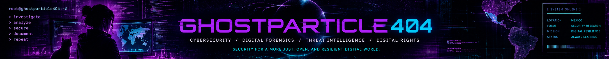

<div align="right">
  <a href="./README.md">
    
  </a>
  <a href="./README.es.md">
    
  </a>
</div>

<div align="center">
  
</div>

<div align="center">


# ⚡ GHOSTPARTICLE404

**Cybersecurity · Digital Forensics · Threat Intelligence · Network Security · Digital Rights**

`root@ghostparticle404:~# whoami`

*Security architecture. Technical investigation. Digital resilience.*

<p align="center">
  <a href="#cnsd"></a>
  <a href="#ahmo-nimahui"></a>
  <a href="#technical-arsenal"></a>
  <a href="#digital-rights"></a>
  <a href="#homelab"></a>
</p>

`[ THINK SYSTEMICALLY ]` · `[ INVESTIGATE DEEPLY ]` · `[ SECURE INTENTIONALLY ]`

</div>

---

## 👾 ABOUT ME

I work at the intersection of **cybersecurity, artificial intelligence, digital forensics, international policy, and human rights**.

My work spans security architecture and managed cybersecurity through **Consultoría Nacional de Seguridad Digital (CNSD)**, AI-assisted legal intelligence and institutional accountability through **Ahmo Nimahui**, and research interests in cognitive warfare, information integrity, and digital rights.

My interdisciplinary background in research, education, instructional design, and systems thinking informs how I approach technical investigation, security architecture, and human-centered technology.

`> investigate. architect. secure. advocate. document.`

---

<a id="cnsd"></a>


## 🛡️ CNSD | CONSULTORÍA NACIONAL DE SEGURIDAD DIGITAL

**CYBERSECURITY CONSULTING & MANAGED SECURITY | MÉXICO**

`ghostparticle404@cnsd:~$ cat services.conf`

**Consultoría Nacional de Seguridad Digital (CNSD)** focuses on practical, scalable cybersecurity for Mexican law firms and small-to-medium organizations.

Our security architecture combines network protection, managed security, endpoint and cloud security, digital resilience, and cybersecurity education.

### 🌐 Network Security & Infrastructure

- Firewall architecture, network hardening, and segmentation
- Secure Wi-Fi, VLAN design, and guest network isolation
- VPNs and secure remote access
- Network traffic analysis and monitoring
- Intrusion detection and prevention
- Network security assessments
- Router, firewall, and access-point configuration

**Technologies:** Firewalla · TP-Link · Wireshark · TShark · tcpdump · Nmap · VPNs · IDS/IPS

### 🖥️ Managed Security & IT Services

CNSD's fractional MSP/MSSP model supports organizations seeking managed cybersecurity, outsourced IT services, or both.

**Managed security**
- Endpoint detection and response
- Security monitoring and alerting
- Vulnerability and patch management
- Endpoint and server hardening
- Incident response planning
- Security configuration and governance

**Managed IT**
- User provisioning and identity management
- Device configuration and administration
- Software deployment and maintenance
- Remote technical support
- Network and infrastructure management

### 🔐 Endpoint, Identity & Cloud Security

- Windows and macOS endpoint security
- Microsoft 365 and Google Workspace security
- Microsoft Entra ID and Intune
- Multifactor authentication and least-privilege controls
- Email security and phishing protection
- Secure collaboration and document management

### 💾 Backup, Recovery & Resilience

- Hybrid cloud and local backup architectures
- NAS/DAS storage and backup planning
- Endpoint and server backup strategies
- Backup verification and recovery testing
- Disaster recovery and business continuity
- Data protection and ransomware preparedness

### 📊 Security Operations

- SIEM architecture and centralized logging
- Endpoint and network telemetry
- Threat detection and event correlation
- Vulnerability assessment
- Indicators of compromise
- Incident investigation workflows

### 🎓 Cybersecurity Education

CNSD develops practical cybersecurity education for legal professionals and administrative staff through realistic workplace scenarios and interactive simulations.

Training topics include phishing, ransomware, business email compromise, secure case-file handling, mobile-device security, identity protection, and incident reporting.

### 🧰 Security Technology Ecosystem

| Area | Technologies |
|---|---|
| Network security | Firewalla, TP-Link, Wireshark, Nmap |
| Endpoint protection | SentinelOne, Microsoft Defender |
| Identity & management | Intune, Entra ID, Microsoft 365 |
| Monitoring | Wazuh, Elastic, Kibana, Sysmon |
| Assessment | Nessus, Nmap |
| Backup & recovery | Acronis, NAS/DAS, hybrid backups |
| Remote administration | Splashtop |

*The technology ecosystem includes platforms used in technical work and products evaluated for client security architectures.*

`[ SECURITY BY DESIGN ]`

`[ PRACTICAL PROTECTION. DIGITAL RESILIENCE. ]`

---

<a id="ahmo-nimahui"></a>

## ⚖️ AHMO NIMAHUI | AI-ASSISTED INSTITUTIONAL ACCOUNTABILITY

**AI · Legal Intelligence · Investigative Research · Human Rights**

`ghostparticle404@ahmo-nimahui:~$ analyze --evidence --timeline --accountability`

**Ahmo Nimahui** is an AI-assisted legal intelligence and institutional accountability project focused on examining complex legal records, reconstructing procedural histories, and identifying patterns across documents and institutional actions.

The project brings together artificial intelligence, legal informatics, investigative methodology, systems analysis, and human-rights research.

### 🔬 Legal Intelligence & Evidence Analysis

- AI-assisted legal document analysis
- Chronological reconstruction of institutional actions
- Procedural compliance and irregularity indicators
- Evidence mapping and source traceability
- Institutional responsibility and decision analysis
- Pattern identification across complex records
- Alternative-hypothesis testing
- Privacy-conscious handling of sensitive information
- Human-validated investigative workflows

### 🧠 Research Methodology

Ahmo Nimahui examines institutional actions not only individually, but also in sequence and context.

Its methodology emphasizes distinguishing documented facts, analytical hypotheses, missing evidence, and competing explanations.

The objective is to support rigorous investigation, transparent analysis, and institutional accountability without replacing legal judgment or treating automated findings as proof of misconduct.

### 🌍 Mission

Developing methods and tools that strengthen access to justice, improve transparency, and support human-rights and institutional accountability research.

`[ THE SEQUENCE IS THE EVIDENCE ]`

`[ TRACEABILITY · ACCOUNTABILITY · HUMAN RIGHTS ]`

---

<a id="digital-rights"></a>


## ⚖️ DIGITAL RIGHTS, CYBERSECURITY & ADVOCACY

### SECURITY IS A HUMAN RIGHTS ISSUE.

`ghostparticle404@advocacy:~$ cat mission.txt`

I approach cybersecurity not only as a technical discipline, but also as a matter of **human rights, privacy, access to justice, cognitive autonomy, and institutional accountability**.

My interests include international cybersecurity policy, digital governance, information integrity, and the protection of individuals and communities navigating complex technological systems.

### 🌍 International Cybersecurity Policy

- International cyber norms and responsible state behavior
- Cyber diplomacy and multilateral cooperation
- Cross-border threats and cybersecurity governance
- International security frameworks
- Technology policy and human rights

### 🧠 Cognitive Warfare & Information Integrity

My research interests include cognitive warfare, information operations, political power, institutional legitimacy, and the security of democratic societies.

**Areas of interest:**

- Cognitive warfare and cognitive security
- Information operations and computational propaganda
- Disinformation and information integrity
- Epistemic security and cognitive autonomy
- Psychological operations and strategic influence
- Cognitive biases and decision-making
- AI-enabled influence operations and synthetic media
- Institutional trust and democratic resilience
- Political ontology, collective memory, and narrative construction
- Hybrid threats and international security
- Cognitive resilience and systemic vulnerability

**Research reference:** *Ontological Foundations of Cognitive Warfare* — NATO Cooperative Cyber Defence Centre of Excellence, 2026.

### 🔐 Privacy & Digital Rights

- Personal data protection and digital privacy
- Surveillance technologies and civil liberties
- Digital autonomy and individual security
- Responsible technology governance
- Protection against technology-facilitated abuse

### ⚖️ Technology, Justice & Accountability

- Digital evidence and forensic integrity
- Technology-facilitated coercion and abuse
- Access to justice in technology-related disputes
- Institutional accountability and procedural safeguards
- Ethical investigations and responsible disclosure

### 🤝 Accessible Cybersecurity

- Practical digital safety education
- Security resources for individuals and small organizations
- Reducing barriers to cybersecurity knowledge
- Community learning and knowledge sharing
- Cybersecurity education for nontechnical audiences

`[ PRIVACY IS A RIGHT ]`

`[ PRESERVE COGNITIVE AUTONOMY ]`

`[ TECHNOLOGY MUST SERVE PEOPLE ]`

---

<a id="technical-arsenal"></a>

## ⚔️ TECHNICAL ARSENAL

`ghostparticle404@kali:~$ tree /security-toolkit/`

A categorized technical reference of security tools, technologies, and workflows spanning reconnaissance, network analysis, web testing, digital forensics, threat detection, and security research.

### 🐉 Kali Linux | Reconnaissance & OSINT

`Nmap` · `theHarvester` · `Maltego` · `Recon-ng` · `SpiderFoot` · `Amass` · `Subfinder` · `dnsenum` · `dnsrecon` · `Fierce` · `Whois` · `WhatWeb` · `Netdiscover`

### 🌐 Network Discovery & Packet Analysis

`Wireshark` · `TShark` · `tcpdump` · `Masscan` · `Netcat` · `Ncat` · `Socat` · `Scapy` · `Ettercap` · `Bettercap` · `hping3` · `arp-scan`

### 🕸️ Web Application Security

`Burp Suite` · `OWASP ZAP` · `Nikto` · `Gobuster` · `ffuf` · `Dirb` · `Dirbuster` · `Feroxbuster` · `sqlmap` · `Wfuzz` · `Commix` · `WPScan` · `Nuclei`

### 🔐 Password & Authentication Auditing

`John the Ripper` · `Hashcat` · `Hydra` · `Medusa` · `CeWL` · `Crunch` · `Hashid` · `Patator` · `Ophcrack`

### 🛡️ Vulnerability Assessment & Exploitation Labs

`Metasploit Framework` · `Searchsploit` · `ExploitDB` · `Nmap NSE` · `Greenbone/OpenVAS` · `RouterSploit` · `BeEF`

### 📡 Wireless Security

`Aircrack-ng` · `Airodump-ng` · `Aireplay-ng` · `Kismet` · `Wifite` · `Reaver` · `Bully` · `hcxdumptool` · `hcxtools`

### 🧬 Digital Forensics & File Analysis

`Autopsy` · `The Sleuth Kit` · `Volatility` · `Binwalk` · `Foremost` · `Scalpel` · `ExifTool` · `bulk_extractor` · `PhotoRec` · `TestDisk` · `dd` · `dc3dd` · `hashdeep`

### 🧩 Reverse Engineering & Binary Analysis

`Ghidra` · `GDB` · `radare2` · `Cutter` · `objdump` · `readelf` · `strace` · `ltrace` · `checksec` · `ROPgadget` · `angr`

### 🔏 Cryptography, Encoding & Steganography

`OpenSSL` · `GnuPG` · `CyberChef` · `Steghide` · `Stegseek` · `zsteg` · `base64` · `xxd`

### 🖥️ Active Directory & Security Labs

`Impacket` · `NetExec` · `Responder` · `Evil-WinRM` · `BloodHound` · `Mimikatz` · `Chisel` · `LinPEAS` · `WinPEAS`

*This is a categorized security-tool reference, not a claim that every utility is installed or used professionally. Security testing is conducted only in authorized environments.*

---

## 💻 OPERATING SYSTEMS & SCRIPTING


**Additional technologies:** Zsh · SQL · Regex · SSH · TLS · HTTP · DNS · TCP/IP · VirtualBox

---

## 📊 SECURITY OPERATIONS & THREAT DETECTION

`Elastic Security` · `Kibana` · `Sysmon` · `Wazuh` · `Splunk` · `Sigma` · `YARA` · `MITRE ATT&CK` · `Suricata` · `Snort` · `Zeek`

**Focus:** Log analysis · Threat detection · Endpoint visibility · Network telemetry · Incident investigation · Detection engineering

---

<a id="homelab"></a>

## 🧪 CYBERSECURITY HOMELAB

`ghostparticle404@homelab:~$ systemctl status lab`

`● cyberlab.service - active`

My cybersecurity homelab provides an operational environment for technical investigation, network analysis, digital forensics, security testing, and hands-on experimentation.

### 🖥️ Lab Environment

- macOS host systems
- Kali Linux and Ubuntu virtual machines
- VirtualBox virtualization
- Network traffic capture and inspection
- Local and external forensic storage
- Terminal-based investigation and scripting workflows

### 🔬 Technical Workflows

**Network analysis:** Packet inspection, DNS analysis, TCP/IP, network enumeration, protocol investigation.

**Digital forensics:** Disk imaging, evidence preservation, metadata analysis, system artifacts, log collection.

**Web security:** HTTP analysis, proxy-based testing, reconnaissance, authorized vulnerability testing.

**Security operations:** Log searching, Sysmon events, telemetry analysis, event correlation.

**Automation:** Bash scripting, Python workflows, command-line processing, reusable technical references.

`[ HOMELAB: OPERATIONAL ]`

---

## 📂 FEATURED PROJECTS

### 🗂️ Obsidian Cybersecurity Vault

**[View Repository](https://github.com/ghostparticle404/obsidian-cybersecurity-vault)**

A Bash-powered organizational framework for a searchable cybersecurity knowledge base, covering CLI commands, security tools, network analysis, forensics, SIEM, OSINT, cryptography, labs, and technical documentation.

### 🛡️ CNSD Security Architecture

Security architectures for Mexican law firms and small organizations, encompassing network protection, endpoint security, identity management, cloud infrastructure, backups, monitoring, incident response, and security education.

### ⚖️ Ahmo Nimahui

AI-assisted legal intelligence and institutional accountability, integrating evidence analysis, procedural chronology, systems thinking, and human-rights methodology.

### 🔬 Digital Forensics & Security Research

Lab-based technical investigations involving macOS security, forensic artifacts, network traffic, system logs, and incident analysis.

---

## 🎓 PROFESSIONAL DEVELOPMENT & COMMUNITY

### Academic & Specialized Studies

- **Columbia University** — AI, Cybersecurity & Governance
- **University of the People** — Data Analytics
- **Harvard CS50** — Computer Science & Programming
- **IBM SkillsBuild** — Cybersecurity Certificate

### Cybersecurity Training

- **Women in CyberSecurity (WiCyS)** — Security Training Scholarship and SANS Skills Quest
- **Just Hacking Training** — Junior Penetration Testing, Web Application Security & Reconnaissance
- **CompTIA Security+** — Security Architecture, Threat Management & Operations

### Professional Communities

- **Women in CyberSecurity (WiCyS)** — Member
- **Rewrite the Code** — Member
- **Just Hacking Training** — Cybersecurity Training Community

### Interdisciplinary Background

Research · Education · Instructional Design · Curriculum Development · Technology · Human Rights Advocacy

---

## 🧠 OPERATING PRINCIPLES

```text
$ cat /etc/security-philosophy

[+] Understand the system before changing it
[+] Question assumptions and verify evidence
[+] Identify the attack surface
[+] Analyze the technical and human context
[+] Distinguish facts from hypotheses
[+] Evaluate risk and unintended consequences
[+] Design practical, defensible controls
[+] Preserve evidence and document methodology
[+] Protect privacy, autonomy, and human rights
[+] Build for resilience, not just compliance
[+] Share knowledge and make security accessible
[+] Never stop learning

SECURITY IS A PROCESS, NOT A PRODUCT.
```
